# Bevy-Editor System Architecture

> **Core Philosophy**: Independent modules and plugins. Every feature is removable, replaceable, and extendable without modifying existing code.
> Confidence: 🟢 Confirmed

---

## 🏛️ Architectural Model & Subsystems

```mermaid
graph TD
    App[Bevy App] --> CorePlugin[CoreEditorPlugin]
    App --> CameraPlugin[EditorCameraPlugin]
    App --> ScenePlugin[SceneManagerPlugin]
    App --> UIPlugin[EditorUiPlugin]
    App --> ExportPlugin[ExportPlugin]
    App --> RemotePlugin[EditorRemotePlugin - BRP/JSON-RPC]

    subgraph "Core Subsystems"
        CorePlugin --> ToolReg[ToolRegistry]
        CorePlugin --> PanelReg[PanelRegistry]
        CorePlugin --> CmdHistory[CommandHistory - Undo/Redo]
        CorePlugin --> EdSel[EditorSelection]
        CorePlugin --> PIE[PlayModeState - Snapshot/Rollback]
    end

    subgraph "Remote & MCP Control (BRP on :15703)"
        RemotePlugin --> BrpStatus[editor/status]
        RemotePlugin --> BrpTree[editor/scene_tree]
        RemotePlugin --> BrpSelect[editor/select]
        RemotePlugin --> BrpSpawn[editor/spawn_primitive]
        RemotePlugin --> BrpPlay[editor/play_mode]
    end

    subgraph "Scene & Assets"
        ScenePlugin --> DWorld[DynamicWorld Serde]
        ScenePlugin --> DragDrop[Smart Ingestion Pipeline]
        ScenePlugin --> Components[Script & Authorable Components]
    end

    subgraph "Decoupled UI Layer"
        UIPlugin --> Insp[Responsive Inspector & Clean Transform]
        UIPlugin --> Hier[Dockable Scene Hierarchy & Outliner]
        UIPlugin --> Browser[Dockable Project Explorer]
        UIPlugin --> Menu[Menu Bar & Project Scaffolder]
        UIPlugin --> PlayBar[PIE Simulation Controls]
        UIPlugin --> StatusBar[Status Bar & Active Context Badge]
    end

    subgraph "Interaction Bus"
        Picking[MeshPickingCamera + Observer] -->|On PointerClick| Insp
        Insp -->|InspectorSelection| EdSel
        EdSel -->|SelectionChangedMessage| StatusBar
    end
```

---

## 🔌 Inter-Module Communication Protocol

Modules NEVER invoke private internals of other modules. Communication occurs through 4 designated conduits:

1. **Messages / Events**:
   - `SelectionChangedMessage`: Emitted when active entities change.
   - `RefreshAssetBrowserMessage`: Emitted when files are imported to reload folder views.
   - `ToggleExplorerDockMessage` & `ToggleDockMessage`: Panel collapse triggers.
   - `TransformNudgeAction` & `AddComponentKind`: Command actions.
2. **Resources**:
   - `EditorSelection`, `InspectorSelection`: Selection state.
   - `PlayModeState`: Current simulation phase (`Edit`, `Playing`, `Paused`).
   - `HoveredAssetDirectory`: Context-aware drop destination.
   - `ExportStatus`: Background job feedback.
3. **Commands & Traits**:
   - `EditorCommand`: Undo/Redo encapsulation.
   - `EditorTool`: Tool registration (`id`, `name`, `activate`).
   - `EditorPanel`: Panel registration.
   - `Exporter`: Build packaging target.
4. **ECS Markers**:
   - `EditorInternal`: Protects editor UI and cameras from scene clearance or export.
   - `SceneEntity`: Identifies authorable user entities.
